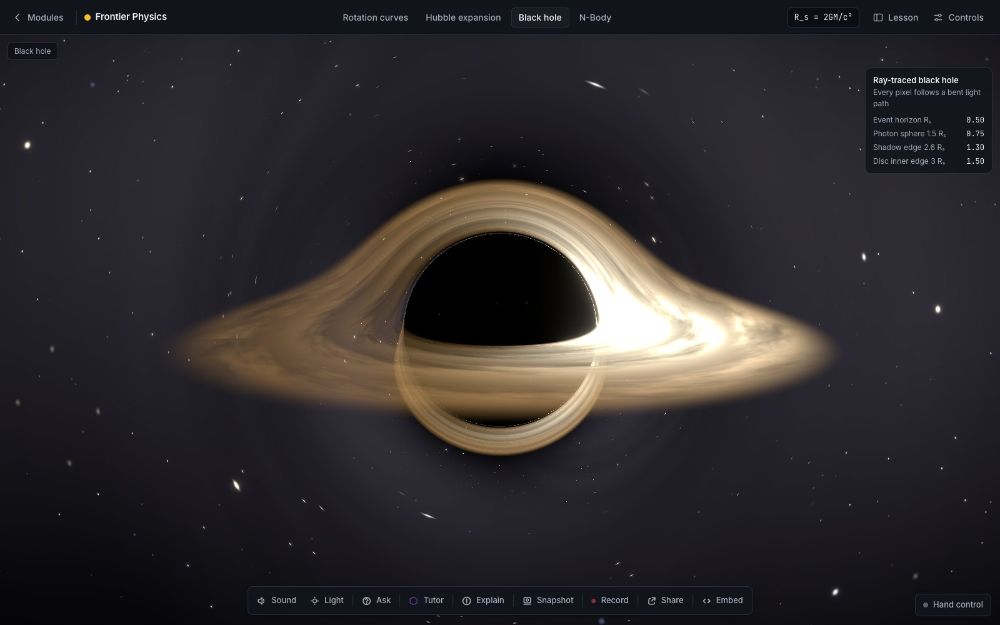
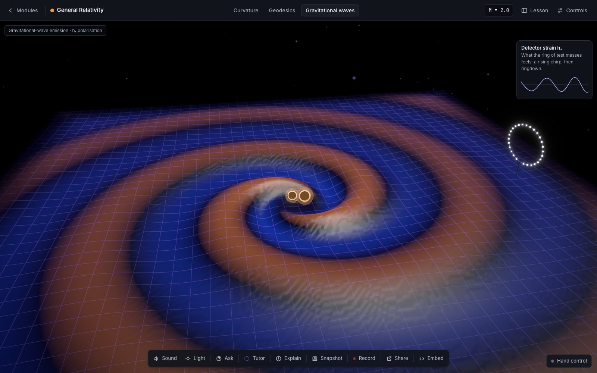
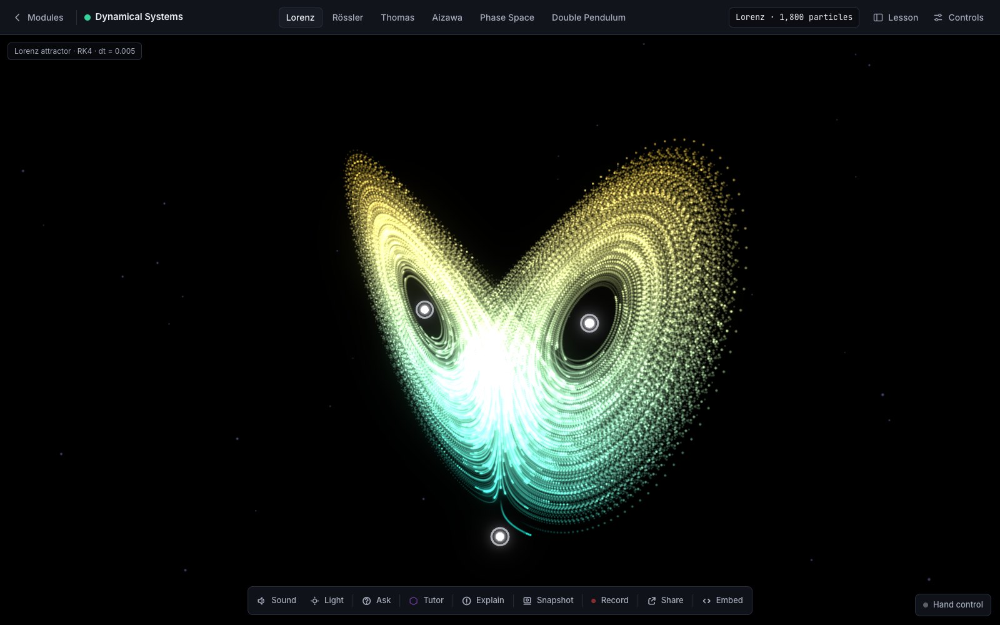
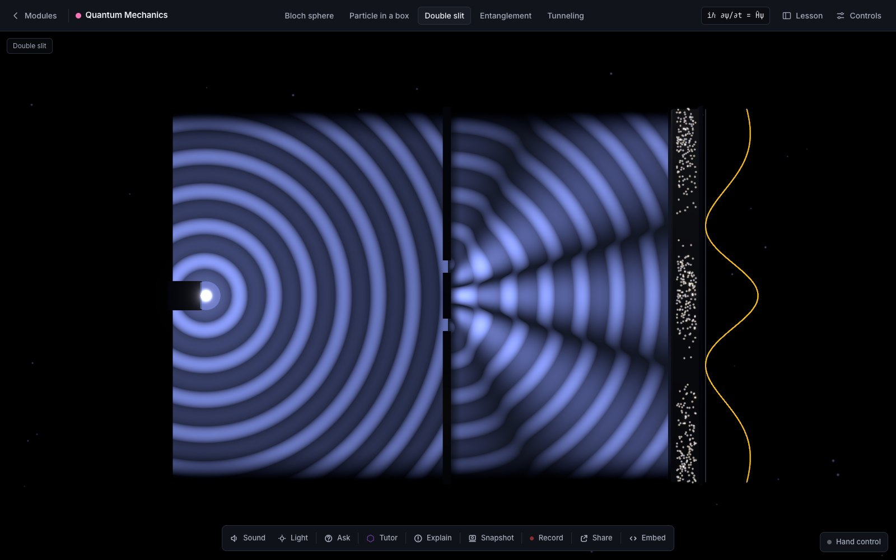
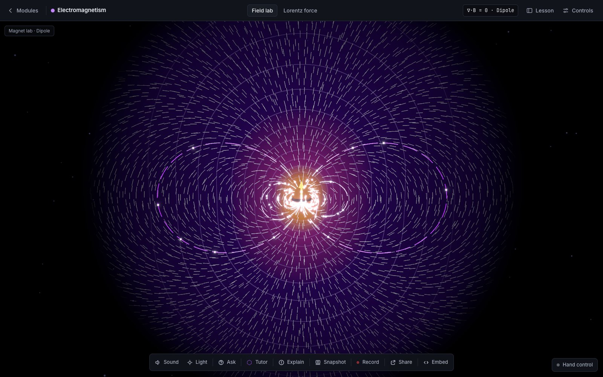
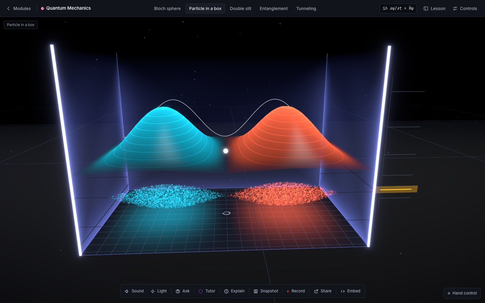
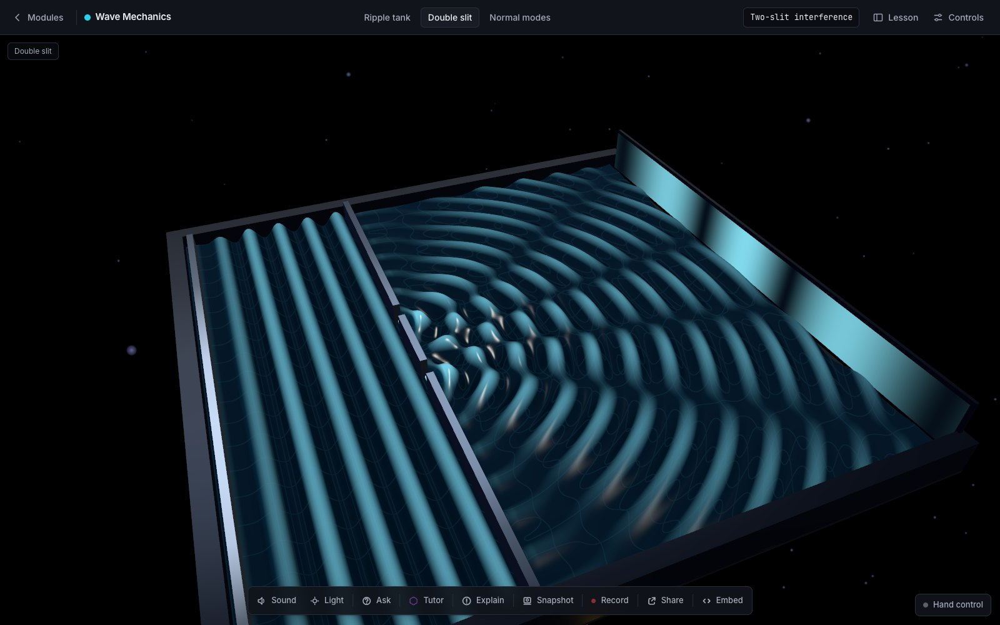
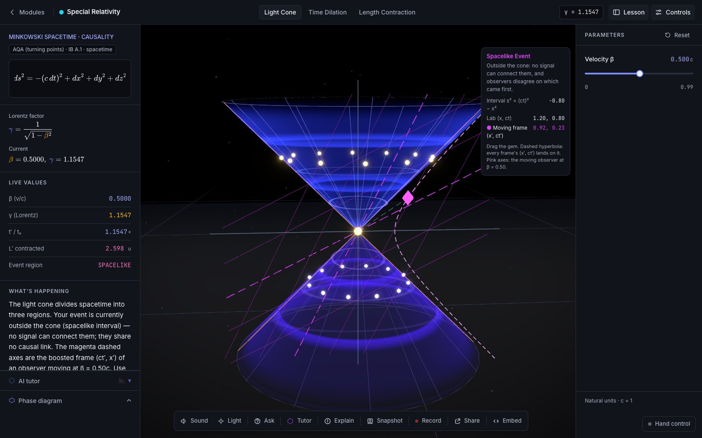
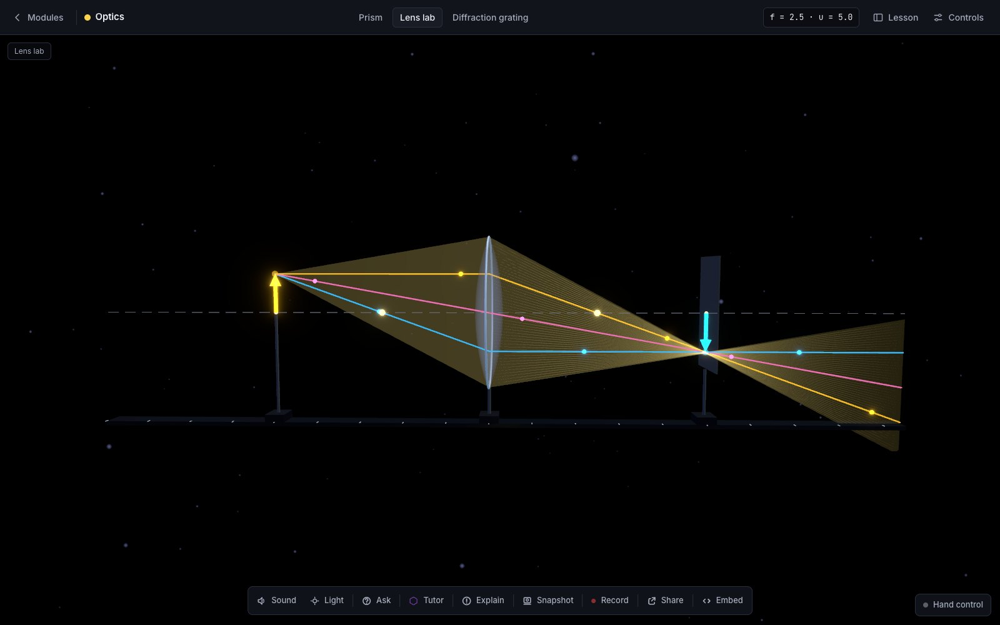

<div align="center">

# Umbra

### Interactive 3D physics simulations that run in your browser

40 real-time simulations across 12 topics, from light cones and qubits to black holes and chaos.<br>
Each one shows the governing equation, a short lesson and an AI tutor that can see what is on screen.

**[Open Umbra →](https://umbrasandbox.com)** &nbsp;·&nbsp; [All simulations](https://umbrasandbox.com/simulations) &nbsp;·&nbsp; [For teachers](#for-teachers) &nbsp;·&nbsp; [Run it locally](#run-it-locally)

[](https://github.com/sub7an/umbra/actions/workflows/test.yml)
[](LICENSE)
[](https://umbrasandbox.com)

<a href="https://umbrasandbox.com/simulations/frontier-physics"></a>

</div>

## Why Umbra

Physics is easier to understand when you can change it and watch what happens. Umbra turns the equations from A-level, IB and first-year university physics into simulations you can drag, tune and break, right in a browser tab.

- **Computed, not animated.** Orbits come from the Schwarzschild geodesic equation, field lines are traced through the real magnetic field, waves are solved on a grid. 52 automated tests check the maths.
- **A lesson beside every simulation.** The equation, live values, a plain-English explanation, things to try and predict-first questions.
- **An AI tutor that sees the screen.** Ask about the exact state you are looking at, or click anything to have it explained.
- **Free and instant.** No account, no install. Works on a school laptop and on a classroom projector.

## Gallery

<table>
  <tr>
    <td width="50%"><a href="https://umbrasandbox.com/simulations/general-relativity"></a><br><b>Gravitational waves.</b> Two black holes inspiral, merge and ring down. A detector ring stretches as the chirp passes.</td>
    <td width="50%"><a href="https://umbrasandbox.com/simulations/dynamical-systems"></a><br><b>Lorenz attractor.</b> 1,800 particles trace the butterfly. Tune σ, ρ and β and watch chaos switch on.</td>
  </tr>
  <tr>
    <td><a href="https://umbrasandbox.com/simulations/quantum-mechanics"></a><br><b>Double slit.</b> The wave interferes, single particle hits build the fringes, and measuring the slit makes them vanish.</td>
    <td><a href="https://umbrasandbox.com/simulations/electromagnetism"></a><br><b>Magnetic fields.</b> Thousands of iron filings and 3D field lines for dipoles, bar magnets, solenoids and Halbach arrays.</td>
  </tr>
  <tr>
    <td><a href="https://umbrasandbox.com/simulations/quantum-mechanics"></a><br><b>Particle in a box.</b> The wavefunction coloured by its complex phase, with nodes, energy levels and position samples.</td>
    <td><a href="https://umbrasandbox.com/simulations/wave-mechanics"></a><br><b>Ripple tank.</b> A live wave-equation solver with realistic water. Click to add sources and slits.</td>
  </tr>
  <tr>
    <td><a href="https://umbrasandbox.com/simulations/special-relativity"></a><br><b>Light cone.</b> Drag an event through spacetime. The lesson panel and controls sit beside every simulation.</td>
    <td><a href="https://umbrasandbox.com/simulations/optics"></a><br><b>Lens lab.</b> Move the object and the principal rays find the real or virtual image.</td>
  </tr>
</table>

## All simulations

| Topic | What you can explore |
|---|---|
| [Special relativity](https://umbrasandbox.com/simulations/special-relativity) | Light cone, light-clock time dilation, length contraction |
| [Quantum mechanics](https://umbrasandbox.com/simulations/quantum-mechanics) | Bloch sphere and gates, particle in a box, double slit, entanglement, tunnelling |
| [General relativity](https://umbrasandbox.com/simulations/general-relativity) | Spacetime curvature, precessing orbits and bent light, gravitational waves |
| [Frontier physics](https://umbrasandbox.com/simulations/frontier-physics) | Ray-traced black hole, galaxy rotation curves and dark matter, Hubble expansion, N-body |
| [Dynamical systems](https://umbrasandbox.com/simulations/dynamical-systems) | Lorenz, Rössler, Thomas and Aizawa attractors, Van der Pol phase space, double pendulum |
| [Electromagnetism](https://umbrasandbox.com/simulations/electromagnetism) | 3D field lines and iron filings for four magnets, Lorentz force |
| [Wave mechanics](https://umbrasandbox.com/simulations/wave-mechanics) | Ripple tank, Young's double slit, membrane normal modes |
| [Optics](https://umbrasandbox.com/simulations/optics) | Prism dispersion and total internal reflection, lens bench, diffraction grating |
| [Thermodynamics](https://umbrasandbox.com/simulations/thermodynamics) | Maxwell–Boltzmann gas, entropy, Carnot engine, Ising model |
| [Fluid dynamics](https://umbrasandbox.com/simulations/fluid-dynamics) | Streamlines and pressure, Kármán vortex street, SPH dam break |
| [Acoustic physics](https://umbrasandbox.com/simulations/acoustic-physics) | Chladni figures, the harmonic series, Lissajous figures |
| [Physics sandbox](https://umbrasandbox.com/simulations/physics-sandbox) | Build your own field from attractors, repulsors and vortices |

## For teachers

- **Embed any simulation** in Canvas, Moodle, Google Classroom, Notion or a web page:

  ```html
  <iframe src="https://umbrasandbox.com/simulations/general-relativity?embed=1"
          width="800" height="520" style="border:0" allowfullscreen></iframe>
  ```

- **Share an exact setup.** The Share button copies a link that reopens the simulation with the same settings, ready for "open this and predict what happens".
- **Present mode.** Press `P` for a clean full-screen view on a projector.
- **Rooms.** Keep a whole class on the same synced simulation.
- **Guided journeys and daily challenges** for homework and revision.

School and university licensing: [hamzahatef09@gmail.com](mailto:hamzahatef09@gmail.com?subject=Umbra%20school%20license)

## How it is built

| Layer | Tools |
|---|---|
| UI | React 19, Tailwind CSS, Zustand |
| 3D and shaders | Three.js, React Three Fiber, drei, postprocessing, custom GLSL (ray-traced black hole, GPU wave surfaces) |
| Maths | RK4 integrators, finite-difference wave solver, Biot–Savart fields, Schwarzschild geodesics, SPH |
| AI | Claude via a server-side proxy (`api/ai.js`); the API key never reaches the browser |
| Hosting | Vercel (static site, serverless functions, analytics) |
| Optional | Supabase accounts, Stripe payments, MediaPipe hand tracking |

Every simulation has its own crawlable page at `/simulations/<topic>`: the build pre-renders each page's title, description, structured data and lesson content (`scripts/prerender.mjs`, content in `src/content/simulations.js`), then the app takes over in the browser.

```
src/
  modules/<topic>/     one folder per topic: scenes, maths (*.js) and tests (*.test.js)
  components/          app shell, lesson and control panels, toolbar, tutor
  content/             search-facing page content
  store/               Zustand state for every module
api/                   serverless functions (AI proxy, Stripe, telescope feed)
scripts/               build-time pre-rendering, key setup, social card
```

## Run it locally

Requires Node.js 22.

```bash
git clone https://github.com/sub7an/umbra.git
cd umbra
npm install
npm run dev        # http://localhost:5173
npm test           # 52 physics and safety tests (Vitest)
npm run build      # production build + pre-rendered pages, sitemap, llms.txt
```

The simulations need no configuration. To turn on the AI tutor, add an Anthropic API key:

```bash
zsh scripts/set-anthropic-key.sh   # stores ANTHROPIC_API_KEY in .env without echoing it
```

<details>
<summary><b>Accounts (Supabase) and payments (Stripe)</b></summary>

Both are optional. Until they are configured, the app runs normally and the related buttons fall back to a contact flow.

**Supabase accounts**

1. Create a Supabase project and run `supabase-schema.sql` in the SQL Editor.
2. Set `VITE_SUPABASE_URL` and `VITE_SUPABASE_ANON_KEY` (public), and `SUPABASE_SERVICE_ROLE_KEY` (secret, production only).
3. In Supabase → Authentication → URL Configuration, set the Site URL to your domain and add it to the redirect URLs.

**Stripe checkout**

| Variable | Value |
|---|---|
| `STRIPE_SECRET_KEY` | `sk_test_…` then `sk_live_…` (secret) |
| `STRIPE_PRICE_PRO` | `price_…` for the Pro subscription |
| `STRIPE_WEBHOOK_SECRET` | `whsec_…` from the webhook endpoint |

`POST /api/checkout` creates a Checkout Session; `POST /api/stripe-webhook` verifies the signature and flips `is_pro` on the user's profile.

</details>

## Contributing

Issues and pull requests are welcome, especially new simulations, accuracy fixes and accessibility improvements. Keep the physics in a plain `*.js` module next to the scene so it can be tested, add a test for it, and run `npm test` before opening a PR.

## License

[MIT](LICENSE) © 2026 Subhan
